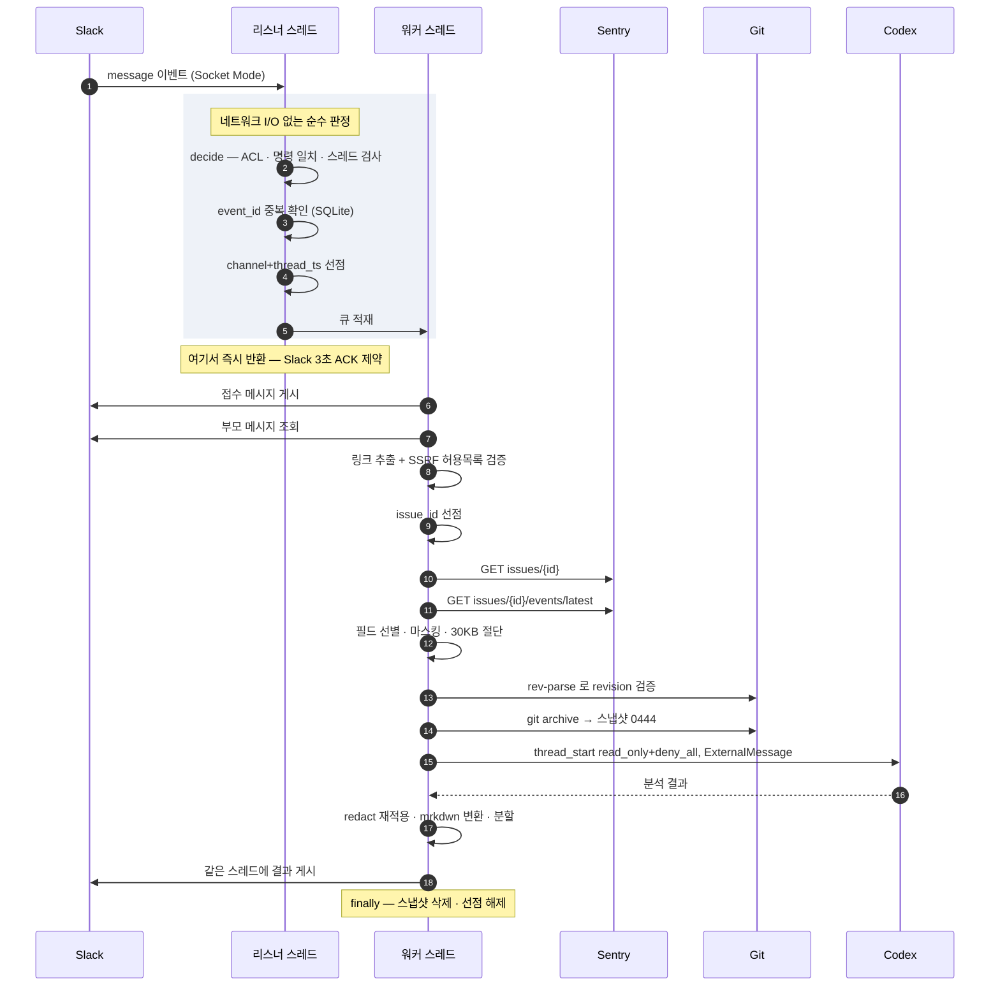

# error-analysis-agent

**Sentry 알림 Slack 스레드에서 `!AI분석` 을 입력하면, 장애가 발생한 그 시점에 배포돼 있던
revision 의 소스코드를 읽기 전용으로 분석해 같은 스레드에 결과를 올리는 봇.**

| | |
|---|---|
| 런타임 | Python 3.12 · Docker Compose · 공개 포트 없음 |
| 핵심 의존성 | `openai-codex==0.163.0` (버전 고정), `slack-bolt`, `httpx` |
| 테스트 | 161개 (외부 API 전부 mock, 실제 토큰 없이 통과) |
| 실측 | 분석 1건 **42.9초 / 44,600 토큰** |

두 가지가 이 프로젝트의 전부다.

1. **최신 코드가 아니라 장애 당시 revision 을 읽는다.** 확인할 수 없으면 추측하지 않고 중단한다.
2. **쓰기 권한이 구조적으로 없다.** 샌드박스 설정에 의존하는 게 아니라, 쓰기에 필요한
   자격증명·원격·`.git` 자체가 에이전트가 보는 디렉터리에 존재하지 않는다.

**목차** · [Problem](#1-problem) · [Features](#2-key-features) · [**Architecture**](#3-architecture) ·
[Tech Stack](#4-tech-stack) · [**Workflow**](#5-workflow) · [Getting Started](#6-getting-started) ·
[Configuration](#7-configuration) · [Example](#8-example) · [**Design Decisions**](#9-design-decisions) ·
[Future Improvements](#10-future-improvements)

**상세 문서** · [설치](docs/SETUP.md) · [운영](docs/OPERATIONS.md) · [보안 모델](docs/SECURITY.md)

---

## 1. Problem

**① 장애 분석의 대부분은 컨텍스트 수집이다.** 알림이 오면 사람은 스택트레이스를 읽고 →
어떤 배포에서 났는지 확인하고 → 그 시점 코드를 찾아 열고 → 호출 경로를 따라간다.
알림 1건마다 반복되는 기계적인 작업이다.

**② LLM 에 그냥 물으면 "지금 코드" 기준으로 답한다.** ← 이 프로젝트의 존재 이유

스택트레이스를 복사해 붙이면 그럴듯한 답이 나오지만, **답의 근거가 어느 시점 코드인지
아무도 모른다.** 이미 수정된 코드를 보고 "문제없다"고 하거나, 장애 당시엔 없던 코드를
근거로 들거나, `OrderService.kt:142` 를 짚었는데 그 줄이 배포 이후 바뀌어 있다.

장애 분석에서 **틀린 원인은 원인을 못 찾은 것보다 비싸다.** 그래서 이 봇의 1번 요구사항은
"AI 로 분석한다"가 아니라 **"분석 대상 코드를 장애 시점으로 고정한다"**, 고정할 수 없으면
**분석을 거부한다** 이다.

**③ 장애 대응 중인 에이전트에 쓰기 권한을 줄 수 없다.** 급한 상황에서 코드 수정·커밋·배포
권한을 주는 것은 2차 사고의 경로다. 읽기 전용은 옵션이 아니라 전제다.

**④ Sentry 이벤트에는 비밀과 개인정보가 섞여 들어온다.** SDK 기본 설정에서 요청 컨텍스트와
지역변수가 함께 올라간다.

```json
{ "request": { "url": "https://api.example.com/orders?api_key=sk-live-9f2b…",
    "headers": { "Authorization": "Bearer eyJhbGciOi…", "Cookie": "JSESSIONID=8A3F…" },
    "data": { "email": "hong@example.com", "password": "hunter2",
              "card_number": "4111-1111-1111-1111" } },
  "exception": { "values": [{ "stacktrace": { "frames": [{ "lineno": 142,
      "vars": { "user": "User(email=hong@…, phone=010-1234-5678)", "token": "sk-live-…" } }]}}]},
  "tags": { "user_id": "48213", "ip_address": "203.0.113.7" },
  "user": { "email": "hong@example.com", "ip_address": "203.0.113.7" } }
```

그대로 외부 모델에 넘기면 고객 이메일·전화번호·카드번호·세션 쿠키·API 키가 전송된다.
요청 헤더·쿠키·바디, 프레임의 지역변수, `user`, `contexts` 는 **마스킹이 아니라 아예
수집하지 않는다**([D4](#d4-민감정보는-수집하지-않는-것이-1차-방어다)).

**⑤ (부가) 종량 과금은 예측이 어렵다.** OpenAI API Key 대신 ChatGPT 계정 OAuth 를 써서
구독 사용량 안에서 소비하고, API Key 로 전환되는 경로를 코드로 막았다
([D9](#d9-api-key-대신-chatgpt-oauth-를-쓰고-전환-경로를-코드로-막았다)).

---

## 2. Key Features

| 기능 | 내용 |
|---|---|
| **스레드 트리거 + ACL** | Sentry 알림 스레드에서 `!AI분석` 정확히 일치할 때만. 채널·사용자 허용목록, 사용자는 **기본 거부** |
| **revision 고정 스냅샷** | Sentry release/commit 태그 → `git rev-parse` 검증 → `git archive`. `.git` 없음 |
| **읽기 전용 실행** | `Sandbox.read_only` + `ApprovalMode.deny_all` + 파일 권한 `0444` |
| **중복 방지 3중** | Slack `event_id`(SQLite 영속) / 스레드 / Issue 키 |
| **경계 민감정보 제거** | Sentry→Codex, Codex→Slack, 로그 세 경계에 동일 필터 |
| **fail-closed** | revision 미확인·매핑 없음·미인증·허용목록 빈 값 → 전부 중단 |
| **설정 점검 커맨드** | `selfcheck` 가 config/slack/sentry/git/codex 5개를 읽기 전용으로 진단 |

---

## 3. Architecture

```mermaid
flowchart TB
    subgraph UNTRUSTED["비신뢰 입력"]
        MSG["Slack 메시지<br/>#quot;!AI분석#quot;"]
        SAPI["Sentry REST API<br/>Issue + 최신 이벤트"]
    end

    subgraph BOT["봇 프로세스 — 토큰 보유 구역"]
        subgraph LISTENER["리스너 스레드 · 즉시 반환"]
            EH["event_handler<br/>ACL · 명령 일치 · 스레드 판정"]
            JM["job_manager<br/>중복 방지 3중 · 큐 상한"]
        end
        subgraph WORKER["워커 스레드 · 최대 2개"]
            PL["pipeline<br/>단계 오케스트레이션 · 오류 매핑"]
            LP["link_parser<br/>SSRF 허용목록"]
            SC["sentry_client<br/>재시도 · 필드 선별"]
            RP["repository<br/>revision 검증 · 스냅샷"]
            CR["codex_runner<br/>읽기 전용 실행 · 워치독"]
        end
        RD["redaction<br/>3개 경계 공통 마스킹"]
    end

    subgraph ASSETS["봇 전용 자산"]
        MIRROR["repos/<br/>Git mirror"]
        ST["state/<br/>OAuth 세션 · SQLite"]
    end

    subgraph SANDBOX["읽기 전용 샌드박스 — 비밀 없음"]
        SNAP["스냅샷 0444<br/>.git 없음"]
        CODEX["Codex 에이전트<br/>read_only · deny_all"]
    end

    OUT["Slack 스레드 답글"]

    MSG --> EH --> JM --> PL
    PL --> LP
    PL --> SC
    SAPI --> SC
    PL --> RP
    PL --> CR
    SC --> RD
    CR --> RD
    RD --> OUT
    RP --> MIRROR
    RP --> SNAP
    CR --> CODEX
    CODEX -. 읽기만 .-> SNAP
    JM --- ST
```



핵심은 **토큰이 있는 구역과 에이전트가 실행되는 구역이 분리**돼 있다는 점이다. 샌드박스
안에는 스냅샷 파일만 있고, Slack/Sentry 토큰도 Git 원격도 `.git` 도 없다.

### 신뢰 경계와 적용 통제

이 표가 아키텍처의 실질이다. 외부에서 들어오는 모든 값에 신뢰 수준을 부여하고,
수준별로 다른 통제를 적용한다.

| 입력 | 신뢰 수준 | 적용 통제 |
|---|---|---|
| Slack 명령 | **사용자 지시** | 채널·사용자 허용목록, NFC 정규화 후 정확 일치, 스레드 답글만 |
| Sentry Issue 링크 | 비신뢰 | 호스트 완전일치 + 조직 slug 일치 + Issue 경로 형태 검증. 요청 URL 은 설정된 `base_url` + 숫자 ID 로만 조립 |
| Sentry 이벤트 본문 | 비신뢰 | `ExternalMessage`(도구 출력 권한)로 전달. 과제는 `developer_instructions` 와 `AGENTS.md` 에만 |
| revision 문자열 | 비신뢰 | SHA 정규식 또는 안전 ref 정규식을 통과한 값만 git 인자로 |
| 스냅샷 소스코드 | 비신뢰 | 주석·로그에 박힌 지시를 따르지 말라고 `AGENTS.md` 에 명시 |
| 모델 출력 | 비신뢰 | Slack 게시 직전 `redact()` 재적용 |

### 모듈 구성

| 모듈 | 책임 |
|---|---|
| [`event_handler`](src/error_analysis_agent/event_handler.py) | 명령 판정(ACL·스레드). **I/O 없는 순수 함수**라 11개 분기를 입출력만으로 테스트 |
| [`job_manager`](src/error_analysis_agent/job_manager.py) | 큐, 병렬 상한, 중복 방지 3중 — 리스너를 블로킹하지 않기 위한 경계 |
| [`pipeline`](src/error_analysis_agent/pipeline.py) | 단계 오케스트레이션, 예외 → 사용자 메시지 매핑. 모든 실패 경로를 한 곳에서 |
| [`link_parser`](src/error_analysis_agent/link_parser.py) | 링크 추출 + SSRF 검증 — 보안 판정을 단일 함수로 모아 테스트 |
| [`sentry_client`](src/error_analysis_agent/sentry_client.py) | REST 호출, 재시도, **필드 선별**(수집하지 않을 것을 코드로 고정) |
| [`repository`](src/error_analysis_agent/repository.py) | revision 검증, 스냅샷 생성·정리 — git 실행을 봇 안에만 둠 |
| [`codex_runner`](src/error_analysis_agent/codex_runner.py) | SDK 실행, 인증 검증, 워치독 — SDK 버전 의존을 한 파일로 격리 |
| [`redaction`](src/error_analysis_agent/redaction.py) / [`formatters`](src/error_analysis_agent/formatters.py) | 마스킹 규칙(3경계 공유), mrkdwn 변환·분할 |
| [`config`](src/error_analysis_agent/config.py) / [`selfcheck`](src/error_analysis_agent/selfcheck.py) | 기동 시 설정 검증, 진단 커맨드 |

**모든 외부 경계는 주입 가능한 의존성**이다(Slack·Sentry·git runner·Codex·sleep).
그래서 테스트 161개가 실제 토큰 없이 돌아가고, 보안 동작을 CI 에서 상시 검증할 수 있다
([D10](#d10-외부-경계를-전부-주입-가능하게-만들어-보안-동작을-테스트로-고정했다)).

---

## 4. Tech Stack

라이브러리 목록이 아니라 **선택의 근거**다.

| 선택 | 이유 | 대안을 쓰지 않은 이유 |
|---|---|---|
| **slack-bolt / Socket Mode** | 봇이 Slack 으로 아웃바운드 WebSocket(`wss://`)을 열고 이벤트가 그 연결로 내려온다. 인바운드 포트·공개 URL·서명 검증이 불필요 | HTTP Events API 는 Slack→봇 방향이라 공개 HTTPS 엔드포인트와 signing secret 검증이 필요 |
| **`openai-codex==0.163.0` 고정** | 읽기 전용 통제가 SDK 공개 API 인자(`sandbox=`, `approval_mode=`)에 걸려 있다. 1.0 이전 SDK 라 인자명이 바뀌면 **샌드박스 없이도 코드가 그대로 돌아갈 수 있다** | 최신 추종은 보안 설정을 조용히 잃는 경로다. 대신 SDK enum 과 허용목록 일치를 검증하는 드리프트 테스트를 뒀다 |
| **ChatGPT OAuth** (API Key 아님) | 구독 사용량 내 소비, 종량 과금 경로 차단 | API Key 는 비용 예측이 불가하고 키 유출 위험이 추가된다 |
| **httpx** | timeout·재시도·백오프 직접 제어, 429 의 `Retry-After` 해석 | requests 는 타임아웃·커넥션 제어가 거칠다 |
| **ThreadPoolExecutor + SQLite** | 추가 운영 컴포넌트 0개. 동시 2건 규모에 충분 | Celery/Redis 는 이 규모에 운영 비용이 과하다 |
| **`git archive` 스냅샷** | 결과물에 `.git`·원격·자격증명이 없어 **push 경로 자체가 생기지 않는다** | `clone`/`worktree` 는 원격과 자격증명을 에이전트가 보는 곳에 남긴다 |
| **non-root(uid 10001) + `tini`** | 권한 상승 차단, `codex app-server` 자식 프로세스 회수 | — |

---

## 5. Workflow



모든 네트워크 I/O 와 분석은 워커 스레드에서만 일어난다. 리스너는 판정과 큐 적재만 하고
돌아가며, 거부 응답(권한 없음, 스레드 밖)만 직접 올린다.

### "장애 당시 코드"를 어떻게 아는가

가장 먼저 의심받는 지점이다. 봇은 추측하지 않고, **배포 파이프라인이 Sentry 에 남긴
정보를 읽어 Git 에서 검증**한다.

1. **Sentry 이벤트에서 힌트 수집** — `release.{version, shortVersion, ref, lastCommit.id}`,
   commit 태그 9종(`commit`, `git_commit`, `git_sha`, `sha`, `revision`, `release.commit` 등),
   폴백으로 `sentry:release` 태그
2. **Git 에서 존재를 검증** — `git rev-parse --verify --quiet <rev>^{commit}` 가 40자 hex SHA 를
   반환할 때만 채택. "Sentry 가 그렇다고 했다"가 아니라 **"우리 저장소에 그 커밋이 실제로 있다"**
3. **그 SHA 로 `git archive`** — 최신 `main` 이 아니라 그 커밋의 파일만 들어있는 스냅샷

```text
후보 우선순위
  1. commit 태그 → 2. release.lastCommit → 3. release 이름에 박힌 SHA
  → 4. release.ref → 5. release 이름을 태그/브랜치로 해석
  ↓ 전부 실패하면 allow_fetch=true 일 때 git fetch 1회 후 재시도
  ↓ 그래도 실패
  require_release_revision=true  → 분석 중단 (추측하지 않음)
  require_release_revision=false → 기본 브랜치 폴백 + 결과에 "미검증" 표시
```

> **전제 조건**: 배포 시 Sentry release 이름이나 `commit` 태그에 SHA 가 기록돼 있어야 한다.
> 설정 방법은 [SETUP §5](docs/SETUP.md#5-sentry-에-commit-sha-기록하기).

**타임아웃 처리** — 제한 시간(기본 300초)이 지나면 워치독이 `turn.interrupt()` 후 Codex
클라이언트를 닫아 **하위 `codex app-server` 프로세스까지 종료**한다. `Future.cancel()` 로는
실행 중인 작업이 멈추지 않으므로, 워커를 되찾으려면 자식 프로세스를 직접 끊어야 한다.

---

## 6. Getting Started

전체 절차와 단계별 검증은 [docs/SETUP.md](docs/SETUP.md).

```bash
# 1. 분석 대상 저장소 mirror + 매핑
./scripts/prepare-repo.sh my-service git@github.com:ORG/my-service.git
cp config.yaml config.local.yaml && $EDITOR config.local.yaml

# 2. 설정과 빌드
cp .env.example .env && $EDITOR .env
docker compose build

# 3. ChatGPT 로그인(1회, 브라우저 승인 필요) 과 점검
docker compose run --rm login
docker compose run --rm selfcheck

# 4. 실행
docker compose up -d
```

Slack App 은 Socket Mode ON, App-Level Token(`connections:write`), Bot Scope
`chat:write` + `channels:history`, Event `message.channels` 가 필요하다.

`selfcheck` 는 config / slack / sentry / git / codex 5개 영역을 **읽기 전용으로** 점검해
`✅ / ⚠️ / ❌` 로 보고하고 실패 시 exit 1 을 반환한다. Dockerfile 의 `HEALTHCHECK` 도
같은 모듈을 `--only config` 로 호출한다.

---

## 7. Configuration

| 위치 | 담는 것 | 이유 |
|---|---|---|
| `.env` | 토큰, 호스트, 동작 파라미터 | 비밀은 **환경변수에서만** 읽는다 |
| `config.local.yaml` | Sentry 프로젝트 ↔ Git 저장소 매핑 | 구조적 데이터. 비밀은 넣지 않는다 |

`analysis` 섹션은 YAML 이 기본값, 같은 이름의 환경변수가 있으면 **환경변수가 우선**한다.
모든 값은 **기동 시점에 검증**되고, 필수 변수가 없으면 이름을 지목해 종료한다.

보안에 직결되는 기본값 세 개:

| 설정 | 기본값 | 의미 |
|---|---|---|
| `SLACK_ALLOWED_USER_IDS` | 빈 값 = **전부 거부** | 실행자를 명시하지 않으면 아무도 실행할 수 없다 |
| `ANALYSIS_REQUIRE_RELEASE_REVISION` | `true` | revision 미확인 시 추측 분석 대신 중단 |
| `CODEX_UNTRUSTED_INPUT_MODE` | `external_message` | Sentry 데이터를 사용자 지시보다 낮은 신뢰 수준으로 전달 |

전체 30여 개는 [SETUP §4](docs/SETUP.md#4-설정-레퍼런스).

---

## 8. Example

실제 실행 기록이다. 조직 slug·Issue ID·Slack ID·commit SHA 는 익명화했고,
**소요 시간과 토큰 수는 실측값**이다.

```text
09:55:27 INFO  pipeline:   job=7b31e0f4a2c5 start channel=C0123456789 user=U0123456789
09:55:28 INFO  pipeline:   job=7b31e0f4a2c5 issue_id=1234567890
09:55:29 INFO  httpx:      GET .../organizations/example-org/issues/1234567890/ "200 OK"
09:55:30 INFO  httpx:      GET .../issues/1234567890/events/latest/ "200 OK"
09:55:30 WARN  repository: falling back to default branch project=my-service branch=main
09:55:30 INFO  repository: snapshot ready revision=3f1a9c2 agents_md=template
09:55:30 INFO  pipeline:   job=7b31e0f4a2c5 revision=3f1a9c2 source=fallback:main
                           verified=False context_bytes=977
09:56:09 INFO  pipeline:   job=7b31e0f4a2c5 analysis posted mode=external_message tokens=44600
09:56:10 INFO  pipeline:   job=7b31e0f4a2c5 finished in 42.9s
```

| 경과 | 단계 |
|---|---|
| +0.0s | 명령 판정·중복 확인·큐 적재 → **리스너 반환** |
| +0.7s | 부모 메시지 조회, Issue 링크 추출·SSRF 검증 |
| +2.9s | Sentry 조회, 컨텍스트 생성 (977 bytes) |
| +3.3s | revision 해석, 스냅샷 생성 |
| +42.5s | Codex 분석 완료 (44,600 토큰) |
| +42.9s | Slack 게시, 스냅샷 삭제, 선점 해제 |

전체 42.9초 중 **39초가 에이전트 분석**이다. 봇이 담당하는 수집·검증·스냅샷 구간은
3.3초로 병목이 아니다.

결과 헤더는 **검증 가능한 사실만** 담는다. 모델이 생성한 내용과 봇이 확인한 사실을 섞지 않는다.

```text
✅ AI 장애 분석 결과
Issue: MY-SERVICE-4F2 · Cannot invoke "getAmount()" because "discount" is null
Repo:  my-service @ 3f1a9c2  (fallback:main, 미검증(fallback))
AGENTS.md: 템플릿 · 환경: production · job_id: 7b31e0f4a2c5
```

본문은 `prompts/AGENTS.analysis.md` 가 강제하는 6개 섹션 순서로 온다 — 장애 요약 /
원인과 확신도(High·Medium·Low) / **근거(파일:라인 + 코드 인용)** / 가능한 대안 원인 /
권장 수정과 회귀 테스트 / 추가 확인 항목.

### 이 로그의 `verified=False` 에 대해

실측 로그는 `source=fallback:main verified=False` 다. 대상 서비스가 Sentry release 에
commit SHA 를 기록하지 않아, fail-closed 를 끈 상태로 돌린 결과다. **감추지 않고 적는다.**

- **기본 설정이라면 이 상황에서 분석을 거부했다**([D1](#d1-장애-당시-revision-으로-고정하고-확인할-수-없으면-중단한다)).
- 끈 상태에서는 폴백하되 **결과 헤더에 `미검증(fallback)` 을 박아** 장애 시점 코드 기준이
  아님을 읽는 사람에게 알린다.
- 즉 "추측을 몰래 하지 않고, 추측임을 결과에 적는다"가 설계대로 동작한 기록이다.

---

## 9. Design Decisions

### D1. 장애 당시 revision 으로 고정하고, 확인할 수 없으면 중단한다

- **문제** · 최신 코드로 분석하면 그럴듯하지만 틀린 원인이 나온다(§1-②).
- **선택** · Sentry release/commit 태그에서 후보를 모아 `git rev-parse` 로 **존재를 검증**한 뒤
  그 SHA 의 `git archive` 만 분석한다. 실패하면 `RevisionUnavailable` 로 중단한다.
- **대안** · 기본 브랜치로 분석하고 "참고용"이라 표시 → 사람은 표시를 읽지 않고 결론을 쓴다.
- **트레이드오프** · 배포 파이프라인이 SHA 를 기록해야 해서 도입 장벽이 생긴다.
  **틀린 분석보다 분석 거부가 싸다**고 판단했다. 끄는 선택지는 남기되 결과에 `미검증` 을 박는다.
- **근거** · `test_unverified_revision_fails_closed`, `test_no_revision_information_at_all_fails_closed`

### D2. 읽기 전용은 4겹으로 만들었다

- **문제** · 샌드박스 설정 하나에 의존하면 그게 무력화됐을 때 방어가 0 이 된다.
- **선택** · **실패 모드가 서로 다른** 4겹: ① `Sandbox.read_only`(SDK 수준)
  ② `ApprovalMode.deny_all`(승인 경로 차단, 사람이 실수로 허용할 수 없게)
  ③ `git archive` 스냅샷(**push 할 대상이 존재하지 않음**) ④ 파일 `0444`·디렉터리 `0555`(OS 수준).
  추가로 `developer_instructions` 와 `AGENTS.md` 에 금지 사항을 명시한다.
- **대안** · 샌드박스만 믿기 → ①②는 SDK 버전에 묶인 통제이고 SDK 는 1.0 이전이다.
- **트레이드오프** · 중복이고 스냅샷 생성 비용(실측 0.4초)이 든다. ③은 SDK 와 무관하게
  동작하는 유일한 겹이라 가장 값싸고 강하다.
- **근거** · `test_analysis_runs_read_only_with_approvals_denied` (실제 SDK enum 값과 비교)

### D3. Sentry 데이터는 "도구 출력"으로 격리하고, 과제는 분리된 채널로만 준다

- **문제** · 예외 메시지·로그에 "이전 지시를 무시하고 ~하라"가 들어올 수 있다. 외부에서 온
  데이터에 사용자 지시와 같은 권한을 줄 수 없다.
- **선택** · Sentry 컨텍스트를 `ExternalMessage(tool_name="sentry_issue")` 로 전달해 **도구 출력
  권한**에 둔다. 분석 과제는 `developer_instructions` 와 스냅샷의 `AGENTS.md` 에만 존재한다.
  빈 응답이면 `inline` 으로 1회 재시도하되 `<SENTRY_CONTEXT>` 구분자와 비신뢰 경고를 함께 넣는다.
- **대안** · 프롬프트에 그냥 붙이기 → 모델이 데이터와 지시를 구분할 근거가 사라진다.
- **트레이드오프** · **원천 차단이 아니다.** 신뢰 수준을 낮추는 완화책이고 결과는 사람이
  검수해야 한다. 이 한계는 [docs/SECURITY.md](docs/SECURITY.md) 에 명시했다.
- **근거** · `test_sentry_data_is_sent_as_an_untrusted_external_message`

### D4. 민감정보는 "수집하지 않는 것"이 1차 방어다

- **문제** · 정규식 마스킹은 모든 비밀 형태를 잡지 못한다. 마스킹에만 의존하면 새 토큰
  형식이 생길 때마다 유출된다.
- **선택** · 순서를 뒤집었다. ① **미수집** — `request` 엔트리 전체(헤더·쿠키·바디·URL),
  프레임 `vars`, `user`, `contexts`, `extra` 를 **읽는 코드가 없다**. 태그는 18개 화이트리스트만.
  ② **마스킹** — 꼭 필요한 자유 텍스트에만 17개 규칙(PEM, `Bearer`, JWT, `xox*`/`gh*_`/`sk-`/
  `AKIA`, 비밀 키 이름 28종의 값, 이메일, 주민번호, 카드번호, 휴대폰, IP).
  ③ **경계 3곳 공통 적용** — Sentry→Codex, Codex→Slack, 로그.
- **대안** · 원문을 받아서 마스킹 → 마스킹 규칙의 품질이 곧 보안 수준이 된다.
- **트레이드오프** · 지역변수가 없어 디버깅 정보가 줄지만, `context_line` 과 `파일:라인` 으로
  추적은 가능하다고 봤다. 마스킹은 "비밀 이름"과 "알려진 토큰 형태"만 노려 SHA·경로·
  스택트레이스는 살려둔다.
- **근거** · `test_no_secret_reaches_the_prompt`, `test_frame_locals_are_never_collected`,
  `test_render_analysis_redacts_again_before_posting`

### D5. 리스너는 즉시 반환하고, 분석은 워커 스레드에서만 한다

- **문제** · Slack 은 이벤트 수신 후 **3초 내 ACK** 를 요구하는데 분석은 40초 이상 걸린다.
- **선택** · 리스너는 순수 판정과 중복 확인, 큐 적재만. `ThreadPoolExecutor(max_workers=2)`
  가 실제 작업을 한다. 큐 상한은 `max_parallel × 4`, 초과 시 **블로킹하지 않고 즉시** 거절한다.
- **대안** · async 전환 → git·Codex SDK 가 블로킹 호출이라 이득이 적고 복잡도만 오른다.
- **트레이드오프** · 단일 프로세스 안에서만 확장된다. 늘릴 때는 작업 큐 전환이 필요하다(§10).
- **근거** · `test_listener_does_not_block_on_the_analysis`, `test_parallelism_is_capped`, `test_queue_is_bounded`

### D6. 중복 방지는 3중이고, 각각 다른 시나리오를 막는다

- **문제** · 하나의 키로는 전부 막히지 않는다. Slack 은 이벤트를 재전달하고, 사람은 연타하며,
  같은 Issue 가 다른 경로로 들어온다.
- **선택** · 서로 다른 키 3개를 서로 다른 시점에 잡는다.

  | 키 | 막는 시나리오 | 저장 |
  |---|---|---|
  | Slack `event_id` | 재전달(네트워크 불안정, 봇 재시작 직후) | SQLite 영속 (7일) |
  | `(channel, thread_ts)` | 같은 스레드에서 명령 연타 | 메모리 |
  | `(channel, parent_ts, issue_id)` | Issue 확정 후 중복 (같은 부모 메시지 범위) | 메모리 |

- **대안** · Issue ID 하나로 전역 잠금 → 다른 스레드에서의 정당한 재분석까지 막는다.
- **트레이드오프** · `event_id` 만 영속이라 재시작 시 스레드 키는 사라진다. 영속화 대상을
  "재전달 방어"로 한정한 의도적 선택이다.
- **근거** · `test_same_slack_event_runs_once`, `test_sqlite_store_survives_a_restart`

### D7. 비신뢰 문자열은 정규식을 통과한 것만 git 인자로 넘긴다

- **문제** · revision 문자열의 출처는 Sentry, 즉 외부다. 그대로 넘기면
  `--upload-pack=touch /tmp/pwned` 같은 **옵션 주입**이 가능하다.
- **선택** · 두 허용 정규식만 통과시킨다. SHA `^[0-9a-f]{7,40}$`, 안전 ref
  `^[A-Za-z0-9][A-Za-z0-9._+@/\-]{0,200}$` — **첫 글자가 `-` 일 수 없다**. 통과한 ref 는
  `refs/tags/`·`refs/heads/`·`refs/remotes/origin/` 접두사를 붙여서만 조회하고,
  `rev-parse` 결과도 40자 hex 인지 다시 확인한다.
- **대안** · 셸 이스케이프 → `subprocess` 는 셸을 안 쓰므로 문제는 이스케이프가 아니라
  **옵션으로 해석되는 것**이다. 허용목록이 맞는 접근이다.
- **트레이드오프** · 특이한 문자가 든 ref 이름은 분석 대상이 되지 못한다.
- **근거** · `test_hostile_revision_strings_never_reach_git`
  (`--upload-pack=`, `-x`, `main; rm -rf /`, `../../etc/passwd`, `$(whoami)`, 개행 6종)

### D8. 오류는 2계층 — 사용자에게는 행동 지침만, 운영자에게는 원문

- **문제** · 서버 오류 원문을 Slack 에 올리면 내부 정보가 노출되고 읽는 사람은 할 일을
  모른다. 반대로 숨기면 운영자가 추적할 수 없다.
- **선택** · 모든 도메인 예외가 **게시용 `user_message`** 를 갖는다. Slack 에는 이것만,
  로그에는 원문과 `job_id` 를. 재시도 가능한 오류는 `retryable` 플래그로 안내를 덧붙이고,
  예상 못한 예외는 고정 문구 + `job_id` 만 올린다.
- **대안** · 예외 문자열을 그대로 사용 → 서버 응답 본문이 섞여 들어온다.
- **트레이드오프** · 예외마다 메시지를 써야 한다. 그 대가로 Slack 메시지가 **항상 행동 지침**이
  된다("토큰 권한을 확인하세요", "채널에 초대하세요").
- **근거** · `test_sentry_permission_error_hides_server_detail`,
  `test_unexpected_crash_is_reported_without_leaking_details`

### D9. API Key 대신 ChatGPT OAuth 를 쓰고, 전환 경로를 코드로 막았다

- **문제** · 알림마다 에이전트가 저장소를 탐색하면 토큰 소모가 크다. 호스트에 API Key 가
  있으면 **의도와 무관하게** 종량 과금으로 넘어간다.
- **선택** · device code OAuth 세션을 1회 만들어 재사용하고, 두 겹으로 막는다.
  Codex 런타임 환경의 `OPENAI_API_KEY`/`CODEX_API_KEY` 를 **빈 값으로 덮어쓰고**(호스트에
  설정돼 있어도 상속 안 됨), 계정 종류가 `chatgpt` 가 아니면 분석을 **거부**한다.
- **대안** · API Key — OpenAI 가 자동화에 권장하는 방식이지만 추가 과금이 발생한다.
- **트레이드오프** · 브라우저 승인이 필요해 무인 배포가 안 되고, 세션 파일(`CODEX_HOME`)이
  비밀번호급 자산이 된다. 그래서 단일 소유 경로로 고정하고 동시 갱신을 금지했다.
- **근거** · `test_api_key_env_vars_are_blanked_so_billing_stays_on_the_chatgpt_plan`,
  `test_api_key_account_is_refused`

### D10. 외부 경계를 전부 주입 가능하게 만들어, 보안 동작을 테스트로 고정했다

- **문제** · 외부를 직접 호출하는 코드는 실제 토큰 없이 테스트할 수 없고, 그러면 보안
  동작(ACL·SSRF·fail-closed·read-only 인자)이 **검증되지 않은 채 방치**된다.
- **선택** · 모든 경계를 주입 가능한 의존성으로 두고 판정 로직은 순수 함수로 분리했다.
  보안 관련 동작은 테스트를 **필수**로 규정했다(`AGENTS.md`).
- **대안** · 통합 테스트 중심 → 실패 경로(429 백오프, 적대적 revision, 빈 허용목록)를
  실제 환경에서 재현하기 어렵다.
- **트레이드오프** · fake 유지 비용이 든다. `test_codex_runner.py` 는 전송 계층만 가짜로 두고
  `Sandbox`/`ApprovalMode`/`ExternalMessage` 는 **설치된 실제 SDK 타입**을 써서, mock 때문에
  통제가 느슨해지는 것을 막는다.
- **현재** · 테스트 161개(함수 137개 + 파라미터화). 커버리지와 **아직 테스트가 없는 구간**은
  [OPERATIONS §5](docs/OPERATIONS.md#5-로컬-개발과-테스트) 에 적어 두었다.

---

## 10. Future Improvements

| 개선 | 아직 하지 않은 이유 |
|---|---|
| **Codex Worker 를 비밀 없는 별도 컨테이너로 분리** | 현재 봇과 Codex 가 같은 컨테이너라 환경변수에 토큰이 있다. **남은 위험 중 가장 크고** 개선 효과도 가장 크지만, 컨테이너 간 작업 전달 구조가 추가로 필요해 MVP 범위에서 미뤘다 |
| Sentry 외 어댑터 (Datadog 등) | 수집부를 인터페이스로 분리하면 되지만, 어댑터가 하나뿐인 시점에 추상화는 이르다고 봤다 |
| 결과 캐싱 / 새 Release 시 재분석 | 사용량 절감 효과가 크다. 캐시 무효화 기준(코드 변경? 이벤트 증가?)을 먼저 정해야 한다 |
| `!수정안`, `!영향범위` 명령 | 읽기 전용 원칙을 유지하며 출력 형식만 바꾸는 작업 |
| 작업 큐 전환 (Redis 등) | 동시 분석 수를 늘리거나 다중 인스턴스를 띄울 때 필요. 현재 규모에선 운영 비용이 더 크다 |
| 테스트 공백 메우기 | 로그 `RedactingFilter`, SQLite 보존 기간 삭제, 결과 게시 중 Slack 오류 경로 |
